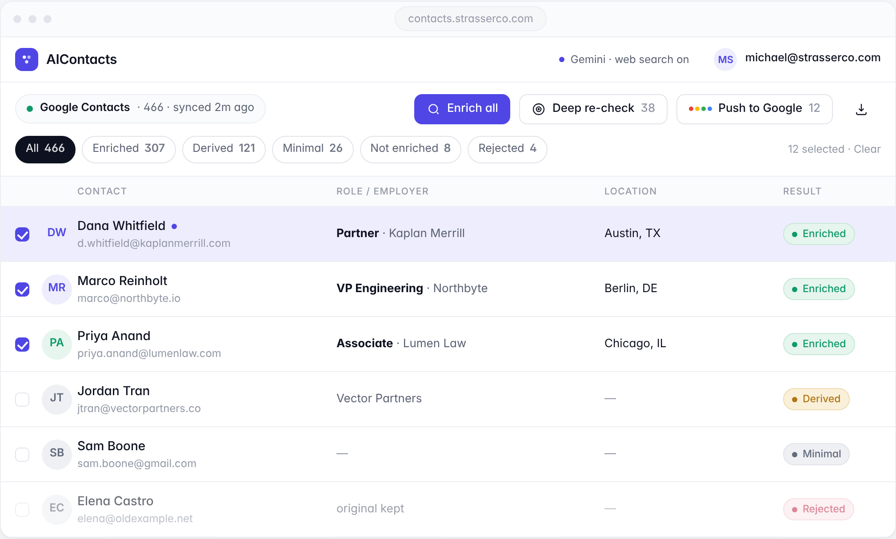
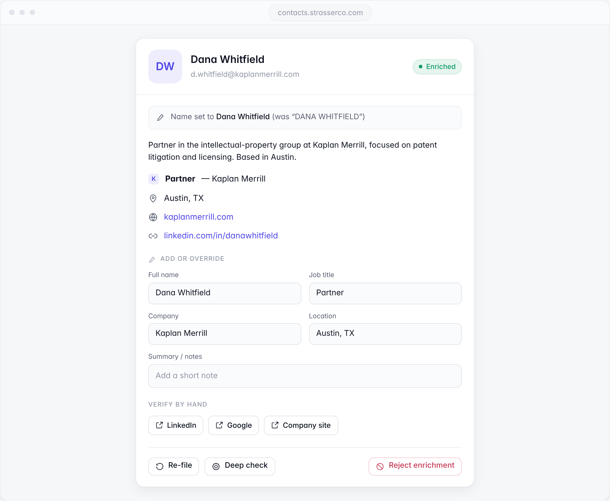
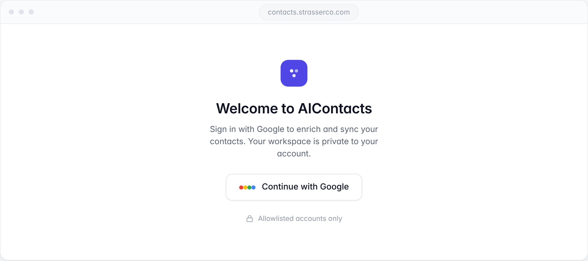
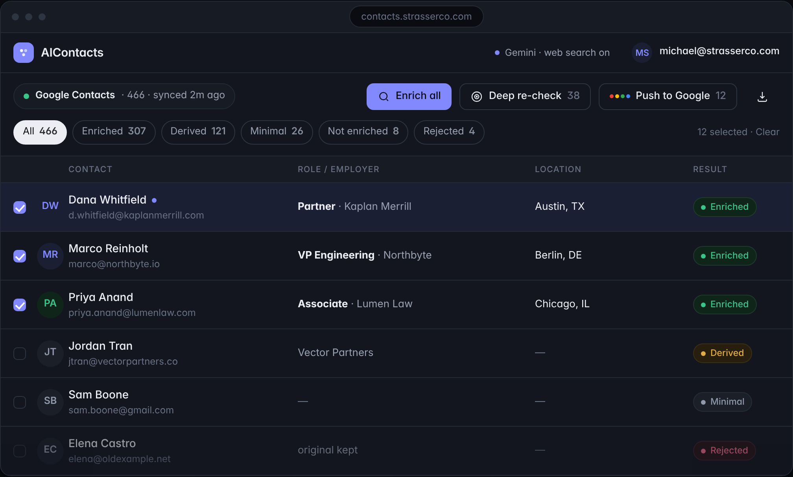
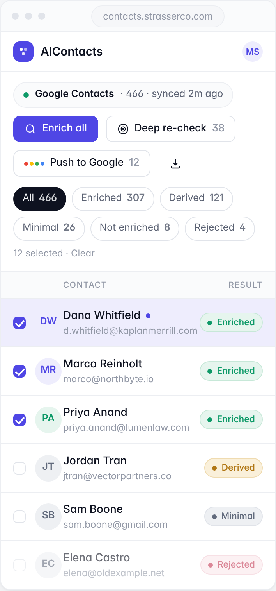
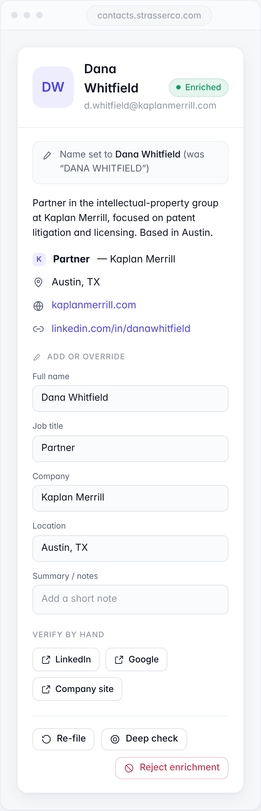
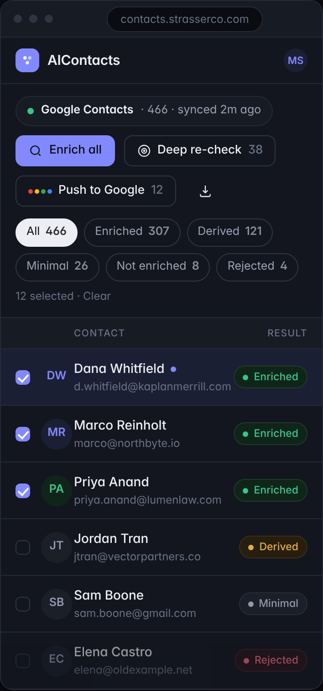

# AIContacts

Enrich your contacts with employment info, location, links, and corrected names — using **your
own** AI provider (Anthropic, OpenAI, or Gemini) — then **sync with Google Contacts** or import/export
CSV. Self-hosted, multi-user, your keys stay on the server. Ships as a prebuilt Docker image.


Repo: <https://github.com/mstras/AIContacts> · Image: `ghcr.io/mstras/aicontacts`

## Screenshots



| Contact detail | Sign in |
| --- | --- |
|  |  |

Dark mode is built in and follows your system (with a manual toggle):



### On a phone

<p>
  
  
  
</p>

> Screens shown with sample data.

## What it does

- **Two sources.** Pull contacts straight from **Google Contacts**, or upload a **CSV**. Same
  enrichment either way.
- **Enrich.** Each contact gets email-derived data (company, website, logo, Gravatar photo), then —
  if an AI provider is configured — a web-grounded **job title, location, profile, and corrected
  name** merged on top. **Deep re-check** re-runs the weak ones with a more thorough search.
- **Review.** Filter by status, correct or override any field by hand (your values win), or reject
  the machine's data for a contact.
- **Sync back.** **Push to Google** writes enriched fields back to Google Contacts — the contacts you
  pick (or all enriched ones) — merging onto each record so existing phones/addresses are preserved.
  Rejected contacts are never written.
- **Per-user & private.** Sign in with Google; each account gets its own persistent workspace (your
  enrichment is saved between visits). An **email allowlist** controls who can sign in.

## Architecture

```
browser ──► Express  ├─ /api/enrich ─► your AI provider (key server-side)
                     ├─ /auth/google ─► Google OAuth (login, allowlisted)
                     └─ /api/sync,/push ─► Google People API (your token, server-side)
                          │
                          └─ SQLite (/data): users, encrypted tokens, per-user contacts
```

A small Express server serves the built React frontend and all APIs. API keys and Google tokens
live on the server (tokens encrypted at rest); the browser only ever talks to this app. With **no**
Google client configured it runs in single-user **local mode** (CSV only, optional Basic Auth).

## Quick start (Docker)

```bash
git clone https://github.com/mstras/AIContacts.git
cd AIContacts
cp .env.example .env        # fill in AI + Google settings (below)
docker compose up -d        # pulls ghcr.io/mstras/aicontacts:latest
```

Open your `PUBLIC_URL` (or `http://localhost:8787`). State persists in the `aicontacts-data` volume.
To build from source instead of pulling, flip `pull_policy`/`build` in `docker-compose.yml`.

## Setting up Google login + Contacts sync

1. In **Google Cloud Console** → create a project → **APIs & Services**.
2. **Enable the People API** (APIs & Services → Library → "People API").
3. **OAuth consent screen**: External, add yourself as a **test user** (or publish). Scopes needed:
   `openid`, `email`, `profile`, and `.../auth/contacts`.
4. **Credentials → Create credentials → OAuth client ID → Web application.**
   - Authorized redirect URI: **`<PUBLIC_URL>/auth/google/callback`**
     (e.g. `https://contacts.example.com/auth/google/callback`).
5. Put the client ID/secret and your `PUBLIC_URL` in `.env`, and list who may sign in:

```
PUBLIC_URL=https://contacts.example.com
GOOGLE_CLIENT_ID=...apps.googleusercontent.com
GOOGLE_CLIENT_SECRET=...
ALLOWED_EMAILS=you@example.com,teammate@example.com
```

`docker compose up -d` and visit the URL — you'll get a **Sign in with Google** screen. Only
allowlisted emails are let in; everyone else is rejected even with a valid Google account.

> Leave `GOOGLE_CLIENT_ID`/`SECRET` blank to skip all of this and run CSV-only local mode.

## Configuration

| Variable | Default | Notes |
|---|---|---|
| `AI_PROVIDER` | _(blank)_ | `anthropic` / `openai` / `gemini`. Blank = email-derived only. |
| `AI_API_KEY` | _(blank)_ | Your key for that provider. |
| `AI_MODEL` | per-provider | Override model. Defaults `claude-sonnet-4-6` / `gpt-4o` / `gemini-2.0-flash`. |
| `AI_MODEL_DEEP` | = `AI_MODEL` | Stronger model used only for **Deep check** passes. |
| `AI_WEB_SEARCH` | `true` | Provider web-search grounding. |
| `PUBLIC_URL` | _(blank)_ | Public origin; required for Google login; enables secure cookies when https. |
| `GOOGLE_CLIENT_ID` / `GOOGLE_CLIENT_SECRET` | _(blank)_ | OAuth client. Blank = local mode. |
| `ALLOWED_EMAILS` | _(blank)_ | Comma-separated emails allowed to sign in. Empty = nobody. |
| `SESSION_SECRET` | auto | Cookie + token encryption key. Auto-generated & persisted if blank. |
| `AUTH_USER` / `AUTH_PASSWORD` | `admin` / _(blank)_ | Optional shared Basic-Auth gate in front of everything. |
| `DATA_DIR` | `/data` | SQLite + secret location (mount as a volume). |
| `PORT` | `8787` | Listen port. |

## Security

- **Allowlist gates sign-in.** Only `ALLOWED_EMAILS` get in, so a public URL can't be used by
  strangers (and can't burn your AI key). Empty allowlist = nobody.
- **Tokens encrypted at rest** (AES-256-GCM) in SQLite under `/data`.
- **Run behind HTTPS.** Secure cookies turn on automatically when `PUBLIC_URL` is https; OAuth and
  Basic Auth both assume TLS at your reverse proxy.
- For an extra outer gate, set `AUTH_PASSWORD` (shared HTTP Basic Auth in front of the Google login).

## Publishing the image (GitHub Actions)

`.github/workflows/docker-publish.yml` builds and pushes to GHCR on every push to `main`/`master`
(→ `:latest`) and on `v*` tags, using the repo's built-in `GITHUB_TOKEN`. Make the package **public**
afterward if you want to pull without logging in.

## Local development

```bash
npm install            # builds the better-sqlite3 native addon (needs python3/make/g++)
cp .env.example .env
npm run dev            # server on :8787, Vite dev server on :5173 (proxies /api)
```

## Notes on accuracy, sync & privacy

AI results can be wrong or stale — per-contact LinkedIn/Google links are there to verify before you
push. **Photos are read-only** (the People API doesn't set photos from URLs). Pushing back writes to
your real Google Contacts, so start with a few selected rows to confirm the mapping before a bulk
push. Enriching contact data is your responsibility under applicable law (e.g. GDPR/CCPA); the tool
does not collect home/street addresses.

## License

MIT — see [LICENSE](./LICENSE).
